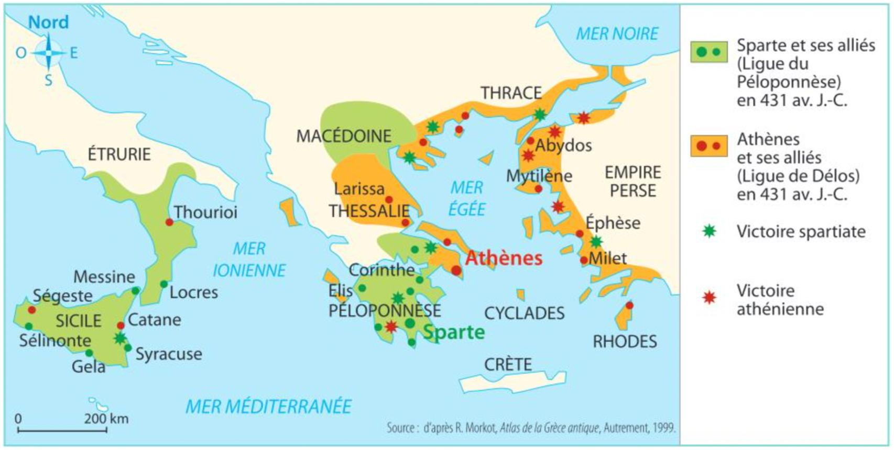

<!---------------------------------------------------------
 - Author: Qirong ZHANG
 - Date: 2026-10-25 16:54:20
 - Github: https://github.com/ShepherdQR
 - LastEditors: Qirong ZHANG
 - LastEditTime: 2026-10-27 23:39:27
 - Copyright (c) 2026 Qirong ZHANG. All rights reserved.
 - SPDX-License-Identifier: LGPL-3.0-or-later.
 --------------------------------------------------------->
---
type: Books
id: "0151"
title: "伯罗奔尼撒战争史"
created: "2026-10-25 16:54:20"
created_date: "2026-10-25"
published: "2026-10-25"
updated: "2026-10-25 16:54:20"
updated_date: "2026-10-25"
slug: "books-0151"
status: "published"
summary: ""
tags: []
series: ""
field_ids: []
revision: "1"
revision_status: "current"
supersedes: ""
superseded_by: ""
errata: []
lead_image: ""
math: false
interactive: false
source:
  date_source:
    created: "new-note"
    published: "new-note"
    updated: "new-note"
---

# 伯罗奔尼撒战争史

- 我们就算从【2026-10-25 16:54:20】开始研究本书
- 是人类文明认识的第一突破口。
- 严格区分：考古出土文物/可靠一直测绘/依据史料的学术复原/实验性重建/艺术性想象。

# 关于本书导读

## Background

本书定位：文明（战争/权利/人性）奠基。以下诸领域的源头：
- 历史学：地理、城邦、殖民网络、希波战争、雅典帝国、斯巴达制度
- 政治哲学
- 国际关系理论
- 军事战略
- 制度研究：民主、寡头、帝国、联盟、财政、海军与战争动员
- 政治修辞学/文本世界：古希腊语、史学叙事、演说、修辞、版本与翻译
- 认识论
- 人类集体行为研究

因果世界：战争起源、结构性压力、偶然事件、政治决策与反事实
人的世界：恐惧、荣誉、利益、瘟疫、暴力、语言腐化、政治判断
跨时代世界：修昔底德与霍布斯、马基雅维利、克劳塞维茨、现代国际关系、演化博弈及复杂系统

## 核心问题

### Level 1：终极问题
一个文明如何在试图维护自身安全、秩序与自由的过程中，逐渐制造出摧毁这些事物的力量？

### Level 2： 核心概念

| 希腊文               | 通常英译                                   | 研究问题                  |
| ----------------- | -------------------------------------- | --------------------- |
| aitia / prophasis | Cause / occasion, pretext, explanation | 表面争端与深层原因究竟如何区分？      |
| phobos            | Fear                                   | 恐惧是心理状态还是制度性安全困境？ 【本书最重要的语义争议】    |
| timē              | Honour                                 | 荣誉、地位、威望与政治承认之间是什么关系？ |
| xympheron         | Interest, advantage                    | 利益是否总能被理性计算？          |
| stasis            | Civil strife, factional conflict       | 内乱是否意味着共同政治语言的崩溃？     |

### Level 3： 学术争论与文本复核

选读 Kagan、de Ste. Croix、Connor、Hornblower；比较关键段落的译法与解释。

### Level 4：一家之言

完成战争因果模型、历史证据图谱与一篇具有明确争论对象的研究论文

### 其他

- 雅典失败原因：盟国暴乱

## 时空结构

状态：
- 政治世界构成：众多自治城邦、殖民地、宗教圣地、海上贸易网络和联盟
- 雅典政治力量来源：舰队、贡赋、盟邦、港口、城墙以及跨海域的动员能力
- 斯巴达：陆军优势；领导伯罗奔尼撒同盟

势力：
- 雅典的海上帝国
- 斯巴达的伯罗奔尼撒同盟
- 独立利益城邦：科林斯、科西拉、底比斯等

时间结构

| 时期         | 关键事件                  | 阅读意义           |
| ---------- | --------------------- | -------------- |
| 前800—前500年 | 希腊城邦形成、殖民扩张、僭主政治与制度变迁 | 理解城邦世界的形成      |
| 前499—前479年 | 希波战争                  | 理解雅典威望与海权的上升   |
| 前478—前431年 | 提洛同盟逐渐帝国化，雅典与斯巴达关系恶化  | 理解战争的结构性原因     |
| 前431—前421年 | 阿基达马斯战争               | 伯里克利战略、瘟疫、战争扩大 |
| 前421—前415年 | 尼基阿斯和约与脆弱和平           | 和平为什么未能消除战争    |
| 前415—前413年 | 西西里远征                 | 帝国扩张与战略灾难      |
| 前413—前404年 | 德凯利亚战争、爱奥尼亚战争         | 雅典失败、波斯介入与联盟重组 |

## 背景知识
### 希腊城邦与民主制度

理解 polis、公民身份、公民大会、五百人议事会、将军、陶片放逐、盟邦与奴隶制度。必须特别研究雅典民主与帝国统治如何同时存在。

推荐：M. H. Hansen, The Athenian Democracy in the Age of Demosthenes；Josiah Ober, Mass and Elite in Democratic Athens。

### 古代军事技术与经济

研究三列桨战船、重装步兵方阵、围城技术、长城墙体系、贡赋、粮食航线与舰队维护。战争不仅是军队的冲突，也是财政与生产体系的竞争。

推荐：J. F. Lazenby, The Peloponnesian War: A Military Study；W. K. Pritchett, The Greek State at War。

### 雅典帝国与史料学

研究提洛同盟转变为帝国的过程，比较修昔底德叙述与贡赋铭文、城邦法令、钱币和其他古代作者的记载。

推荐：Russell Meiggs, The Athenian Empire；G. E. M. de Ste. Croix, The Origins of the Peloponnesian War。

### 希腊思想、悲剧与政治修辞

将修昔底德与埃斯库罗斯、索福克勒斯、欧里庇得斯、智者运动、希波克拉底医学文献对读。关注演说中的正义、必要性、利益和人的处境。

推荐：Jacqueline de Romilly, Thucydides and Athenian Imperialism；W. Robert Connor, Thucydides。

### 宗教、神谕与仪式

修昔底德的历史解释通常不诉诸神明干预，但战争中的希腊人仍然生活在祭祀、神谕、宗教禁忌与神圣空间之中。研究者不能把作者的解释方法误当作当时社会已经彻底世俗化的证明。

Simon Hornblower 关于伯罗奔尼撒战争宗教维度的研究值得专门阅读。

## 文本

### 中文译本

按推荐排名
- 【1】何元国译：《伯罗奔尼撒战争史：修订译本》中国社会科学出版社
- 【2】徐松岩译注：《伯罗奔尼撒战争史》上海人民出版社
- 【3】谢德风译：《伯罗奔尼撒战争史》商务印书馆 · 汉译世界学术名著丛书

### 英文译本

| 版本                                                                    | 主要价值               | 适用场景        |
| --------------------------------------------------------------------- | ------------------ | ----------- |
| Jeremy Mynott, The War of the Peloponnesians and the Athenians (2013) | 注重历史语境，警惕现代概念的时代错置 | 学术精读首选之一 【推荐1】   |
| Robert B. Strassler 编，The Landmark Thucydides (1996)                  | 大量地图、地名资料、索引及辅助说明  | 空间和军事叙事阅读首选 【推荐1】 |
| Martin Hammond, The Peloponnesian War (2009)                          | 现代英语表达与阅读辅助        | 连续通读        |
| Steven Lattimore, The Peloponnesian War (1998)                        | 注重文本结构与语义细节        | 精细对读        |
| Richard Crawley 译本（19世纪）                                              | 公共领域文本，易于数字检索      | 快速查询与历史译法比较 |

### 核心专著
| 研究层次    | 专著                                                                      | 核心用途           |
| ------- | ----------------------------------------------------------------------- | -------------- |
| 历史重建    | Donald Kagan, The Peloponnesian War                                     | 战争全程与历史事件重建    |
| 深层战争原因  | de Ste. Croix, The Origins of the Peloponnesian War                     | 对战争起源的竞争性解释    |
| 帝国制度    | Russell Meiggs, The Athenian Empire                                     | 雅典帝国的组织与经济基础   |
| 战争的社会现实 | Victor Davis Hanson, A War Like No Other                                | 战争的多种暴力形式及社会影响 |
| 叙事与修辞   | W. Robert Connor, Thucydides                                            | 作者的叙事策略与政治思想   |
| 文本结构    | Carolyn Dewald, Thucydides' War Narrative                               | 叙事结构及其解释功能     |
| 叙事解释    | Tim Rood, Thucydides: Narrative and Explanation                         | 历史叙事如何生产因果解释   |
| 文本与历史校勘 | Simon Hornblower, A Commentary on Thucydides, 3 vols.                   | 逐卷深度研究         |
| 大型经典注释  | Gomme, Andrewes & Dover, A Historical Commentary on Thucydides, 5 vols. | 历史、语文学与史料批判    |
| 综合研究    | Brill's Companion to Thucydides                                         | 研究领域与重要争论的系统入口 |

说明：
- 格拉斯哥大学的修昔底德课程书目
- 新研究：Rachel Bruzzone 2025 年出版的 Commentary on Thucydides, Book 3，它专门研究第三卷的文学与思想层面
- Hornblower 三卷注释本和 Gomme 等人的五卷注释本，比一般的概述性著作更重要

### 重要段落
| 位置         | 事件            | 核心问题           |
| ---------- | ------------- | -------------- |
| 1.1—1.23   | 考古篇、史学方法与战争原因 | 历史知识如何可能？      |
| 1.66—1.88  | 斯巴达会议与战争决策    | 安全困境与权力转移      |
| 2.35—2.54  | 伯里克利葬礼演说与雅典瘟疫 | 政治理想与现实灾难      |
| 3.36—3.50  | 米提勒涅辩论        | 帝国惩罚、威慑与政治审议   |
| 3.70—3.85  | 科西拉内乱         | 政治暴力如何摧毁语言与规范  |
| 4.1—4.41   | 皮洛斯与斯法克特里亚战役  | 战场偶然性与战略预期     |
| 5.84—5.116 | 米洛斯对话         | 强权、正义与生存       |
| 6.1—7.87   | 西西里远征         | 决策失灵、信息偏差与帝国灾难 |

### 研究方向

第一，1.23.6：战争的因果结构。 修昔底德对雅典崛起与斯巴达恐惧的解释，可以与现代国际关系中的安全困境、权力转移理论及因果识别方法比较。但不能直接从一个历史案例推出普遍必然性。

第二，3.82：语言、制度与共同现实的崩溃。 科西拉内乱不仅涉及暴力，还涉及政治词语的意义发生变化。可以从语言哲学、社会认识论、规范博弈与制度崩溃研究重新审视这一段。

第三，第六、七卷：战略决策如何形成灾难。 西西里远征是研究信息不对称、集体决策、政治激励、路径依赖与战略过度扩张的经典材料。但需要区分作者提供的史实与现代研究者构建的模型。

战争作为多主体动力系统。 将城邦视为具有内部派系、资源约束、信息局限和联盟关系的行动者，研究局部理性如何产生系统性灾难。可以使用动态博弈、网络科学、机制设计和因果模型，但模型必须接受历史证据约束。

帝国作为基础设施与信息系统。 雅典帝国不仅是军事支配体系，也是港口、税赋、货币、法律、粮食运输与通信构成的网络。可以进一步研究海权、制度协调和资源流之间的结构关系。

历史叙事作为认识论装置。 修昔底德通过选择事件、重构演说、安排叙事顺序，使读者形成对战争的特定理解。历史事实与历史解释之间的关系，本身就是一项值得研究的认识论问题。

文明的自我破坏与制度

## 多模态历史建构

### 战场地形与实地考察

皮洛斯、斯法克特里亚、安菲波利斯、西西里的锡拉库萨，是最值得进行地形复原的地点。结合海岸线、山地、港口与古代道路，研究战役的实际可行性。

J. B. Wilson 的 Thucydides: Pylos 425 BC 就将文本细读与实地地理研究结合。

### 实验考古与三列桨战船

研究复原船 Olympias，观察划桨空间、船员协调、船只转向及海上行动条件。它能帮助理解古代海战的物理约束，但现代复原实验不等于直接证明所有古代舰队的实际性能。

### 铭文学、钱币学与物质文化

从贡赋清单、石刻法令、陶片、钱币、墓葬和城市遗址入手，构建独立于修昔底德叙事的证据体系。尤其要关注实物证据究竟能够证明什么，以及不能证明什么。

### 西西里远征的空间复原

利用锡拉库萨港口、埃庇波莱高地与周边地形，重建围城、舰队调动、补给与撤退的空间关系。这比仅看现代战役动画更接近真正的历史分析。

## 其他数字资源

- [Perseus Digital Library](https://www.perseus.tufts.edu/?utm_source=chatgpt.com)：古希腊文献、译文及语文学资源。
- [ToposText](https://topostext.org/?utm_source=chatgpt.com)：古典文本与地理位置关联。
- [Pleiades](https://pleiades.stoa.org/?utm_source=chatgpt.com)：古代世界地名与历史地理数据库。
- [American School of Classical Studies at Athens](https://www.ascsa.edu.gr/?utm_source=chatgpt.com)：雅典考古、古典研究与相关学术资料。
- [British School at Athens](https://www.bsa.ac.uk/?utm_source=chatgpt.com)：希腊考古与历史研究资源。
- [BBC In Our Time: Thucydides](https://www.bbc.co.uk/programmes/b050bcf1?utm_source=chatgpt.com)：适合作为英文音频讨论的入口。
- [Global Thucydides](https://edizionicafoscari.unive.it/global-thucydides/catalogue/?utm_source=chatgpt.com)：研究修昔底德从中世纪晚期至现代的版本、翻译与接受史。

# Compact

## ch1：历史重构
- 希波战争
- 雅典帝国
- 斯巴达制度
- 地图
- 时间线

## ch2-ch3：政治理想与战争现实
- 葬礼演说
- 瘟疫
- 米提勒涅辩论
- 科西拉内乱

## ch4-ch5：军事行动与不稳定和平
- 皮洛斯战役
- 安菲波利斯
- 尼基阿斯和约
- 米洛斯对话

## ch6-ch7：帝国灾难
- 西西里远征的分析：结合地形/战役/现代决策理论

## ch8：帝国衰败与战争结局
- 接续色诺芬《希腊史》前两卷。

# Books 1 《伯罗奔尼撒战争史》

- 修昔底德著。谢德风译
- 商务印书馆 · 汉译世界学术名著丛书
- （120年纪念版 · 分科本）
- 2017年8月北京第1次印刷
- 20261024晚上7点多借于朝阳图书馆
- 分上下2册。

## Background

## Abstract

- 作者：修昔底德
- 修昔底德自己的言论：有金矿。
- 修昔底德选为将军的任期BC424-BC423.选举是4月或5月，就职是7月或8月，这段时间他在雅典。
- 推测：死时大约50多岁。
- 写作停止在BC411，作品未完成。
- 马克思：伯里克利时代是希腊巅峰。
- 伯里克利时代：四元素论 ==> 种子论 ==> 原子论。 注重修辞和逻辑。怀疑神的存在和奴隶制度的合理性。
- 《物性论》。西塞罗的演说词。维吉尔的诗歌。阿普列乌斯《金驴》。希罗多德。塔西佗。阿庇安。
- 希腊奴隶社会走向衰落时期。奴隶逃走会使得联邦恐慌。
- // 冲突发生在：不同联盟间。联盟主和成员国。平民和贵族。奴隶主和奴隶。
- 部落发展到部族，氏族社会发展为国家的过程中
- 历史方法区别：希罗多德，听到的他即使不相信也记录。修昔底德会判断和筛选。
- 不信神谶：模棱两可，人们有选择相信，贵族的政治工具。

## ch1

科西拉事件
波提狄亚事件

## ch2
## ch3

（密提林暴动）。

科西拉内乱

## ch4
## ch5
## ch6
## ch7
## ch8
（爱奥尼亚附近的暴动）

## Compact

# END

- TODO
- 2026-10-26 23:03:17
