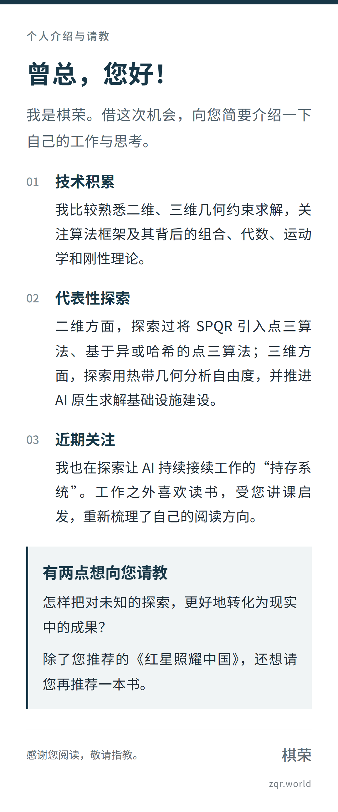
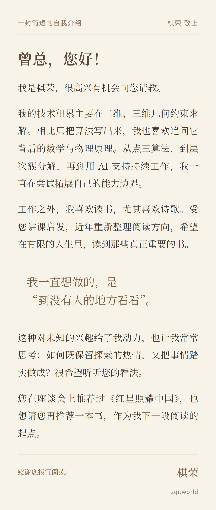
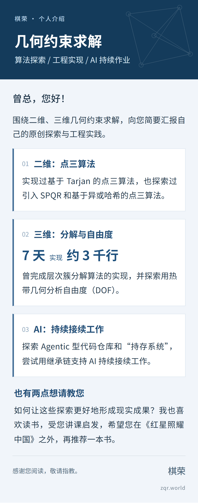
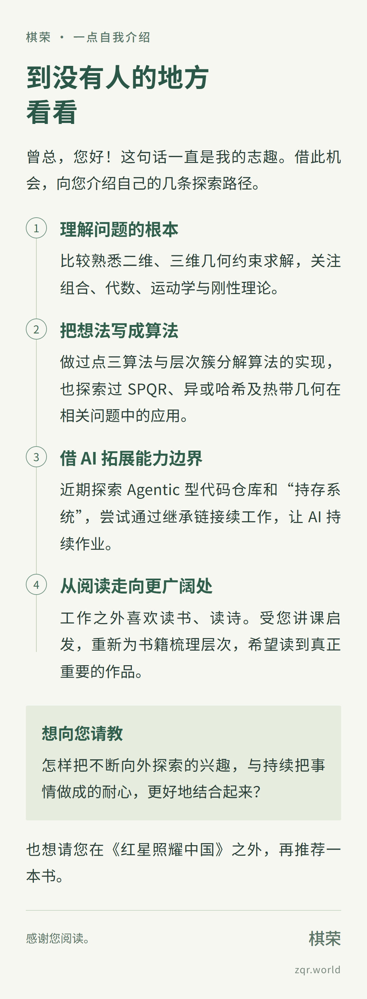
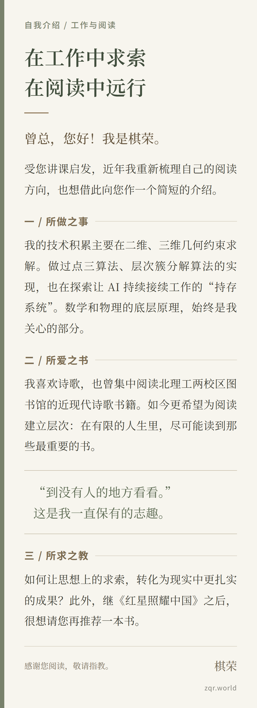
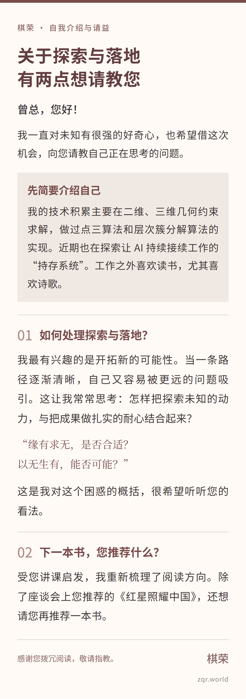

<!---------------------------------------------------------
 - Author: Qirong ZHANG
 - Date: 2026-10-24 16:21:13
 - Github: https://github.com/ShepherdQR
 - LastEditors: Qirong ZHANG
 - LastEditTime: 2026-10-24 18:20:00
 - Copyright (c) 2026 Qirong ZHANG. All rights reserved.
 - SPDX-License-Identifier: LGPL-3.0-or-later.
 --------------------------------------------------------->
---
type: Thoughts
id: "0039"
title: "曾总您好"
created: "2026-10-24 16:21:13"
created_date: "2026-10-24"
published: "2026-10-24"
updated: "2026-10-24 18:20:00"
updated_date: "2026-10-24"
slug: "thoughts-0039"
status: "published"
summary: "第一次向总经理作个人介绍与请教：六种手机阅读版的比较、最终选用的稳重简报，以及关于技术探索、阅读和现实落地的原始思考。"
tags: ["个人介绍", "沟通", "阅读"]
series: ""
field_ids: []
revision: "1"
revision_status: "current"
supersedes: ""
superseded_by: ""
errata: []
lead_image: "/resources/pics/thoughts-0039/01-brief.png"
math: false
interactive: false
source:
  date_source:
    created: "new-note"
    published: "new-note"
    updated: "new-note"
---

# 曾总您好

## 场景与最终选择

这是第一次添加曾总的联系方式。曾总是总经理，此次沟通的目的，是作一个简短的个人介绍与工作汇报，并请教探索与现实落地、下一本阅读书目两个问题。

在保留核心事实和个人气质的前提下，制作了六种适合手机阅读的图片。**最终选择图片 1「稳重简报」作为本次发送版本。** 其余五版作为表达方式的比较与留存。

拟先发送这句问候，再附图片 1：

> 曾总您好，我是棋荣。整理了一份简短的个人介绍，也有两点想向您请教，您方便时再看。

六张图片均在右下角标注 **zqr.world**。

### 图片 1：稳重简报（最终选用）

[查看或保存图片 1 原图](../../../resources/pics/thoughts-0039/01-brief.png)

## 六种风格的分析与取舍

以下是 Codex 基于此次沟通场景，对版式、阅读顺序和表达分寸的分析。

| 图片 | 风格与阅读特点 | 本次场景下的判断 |
| --- | --- | --- |
| **1 · 稳重简报** | 白底、深蓝标题和编号建立清楚的层次；先介绍专业积累，再给出具体探索，最后提出两点请教。 | **最适合首次向总经理介绍自己。** 便于快速了解“我是谁、做过什么、想请教什么”，专业信息充分，语气也克制。 |
| 2 · 真诚书信 | 纸色底、宋体和连贯段落，让阅读接近一封自然的私人书信；“到没有人的地方看看”保留了个人志趣。 | 温和、有交流感，是合适的备选。与图片1相比，技术重点需要从段落中寻找，更适合偏重人与人交流的场景。 |
| 3 · 技术名片 | 深蓝页首和三块技术卡片突出二维算法、三维分解、AI持续作业；“7天、约3千行”形成具体记忆点。 | 专业辨识度强，但缩写和术语较密，整体更像技术履历。适合对方进一步询问技术经历时使用。 |
| 4 · 探索路径 | 纵向路径把数学原理、算法实现、AI和阅读连接起来，呈现兴趣与能力的延伸。 | 有助于理解个人探索的脉络，但展开较长。更适合已有初步了解之后的进一步介绍；图中的顺序是主题脉络，并非严格的时间线。 |
| 5 · 书卷雅致 | 米白底、宋体与分章结构突出阅读、诗歌和思想志趣，也承接了曾总讲课、荐书的缘起。 | 人文气质鲜明，但技术汇报的焦点相对减弱。适合以阅读和荐书为主的交流。 |
| 6 · 坦诚请益 | 直接呈现“探索与落地”的困惑，保留“缘有求无，是否合适？以无生有，能否可能？”两句原问。 | 最有个人辨识度，也最深入。首次联系时，容易让对方先面对一个较大的抽象问题，更适合建立一定了解后再展开。 |

选择图片1，主要考虑的是本次场景中的信息顺序与阅读负担。第一次联系，先让对方形成清楚、稳妥的整体认识，再为后续讨论留下空间。

图片1的最终修订进一步省去了“七天、约三千行”的实现规模描述，将三维部分改为“探索用热带几何分析自由度，并推进 AI 原生求解基础设施建设”，使首次介绍更聚焦研究方向与建设工作。原始经历仍保留在技术名片和下方记录中。

六版的共同处理是统一为第一人称，保留几何约束求解、算法实现、AI持续作业、阅读与探索志趣等核心内容；账号数量、token消耗和极端工作状态等细节留在下方原始记录中，不作为首次介绍的重点。图片中的技术经历依据原稿及本人后续补充，没有新增职务、项目效益或成果评价。

## 其余五种图片

### 图片 2：真诚书信

### 图片 3：技术名片

### 图片 4：探索路径

### 图片 5：书卷雅致

### 图片 6：坦诚请益

## 原始记录

- 想来棋荣是对几何约束求解（2D和3D）比较熟悉：整个框架，包括关涉的数学（组合/代数部分）和物理学（运动学/刚性理论部分）。虽然高一他决定不做数学家，但形式科学究竟是他的本根。
- 比较有代表性的还是他的原创（春花他爱之胜过秋实）：2D这边的点三算法引入SPQR；基于异或哈希的点三算法。3D这边的热带几何做DOF；构建Agentic型Repo
- 个人的巅峰在纯编码阶段：2D这边是基于Tarjan点三算法（3个Splitter）；3D这边是7天实现的3K行的层次簇分解算法
- AI加法时代以来，公司里面的使用，像同事所说的，我个人使用的token和所有其他人加起来一样多。基本思想是以继承链形式，使得24小时AI可持续作业，最多在里面1天用19亿token，我称其为resiliencs系统（持存系统）。
- 工作之外，我喜欢看书。北理工2个校区图书馆的所有近现代诗歌看完后，他就不感有兴趣，因为读完世界所有的书或者诗歌书究竟无望。受曾总讲课启发，近年来在孔网购买了若干书籍，重新开始为人类所有书籍分层，期待人生阅读完所有最重要的书籍。
- 我的人生目标从来没有变过：到没有人的地方看看。最简单的是在思想领域/想象界中。
- 我非常用AI。喜欢巅峰，追求极限，最疯狂时有80个anthropic的20xmax账号，连续用十几个小时的Fable5，不吃不喝的。
- 迷茫是【可能世界与实在界】的摩擦。我想要所有的知识与经验（包括未来的），构建连结一切的【超大陆】；其在现实界的摩擦系人的本身局限性，有死性和同一性。我想应该先解决并行思考，和使得自我可以everywhere。
- 实践领域，事件越发展，其可能性越向想象界塌缩，其成功概率越来越高，我于是越来越不有兴趣，例如10%成功率，因为在想象中已经完成了，其后转向更开阔的话题更有趣，但是究竟大家需要现实，这是困惑的另一表象。
- 希望曾总能够点拨一下：缘有求无，是否合适？以无生有，能否可能？
- 另外，曾总座谈会上推荐了《红星照耀中国》，请曾总再推荐一本书
- 2026-10-24 17:33:39

# END
